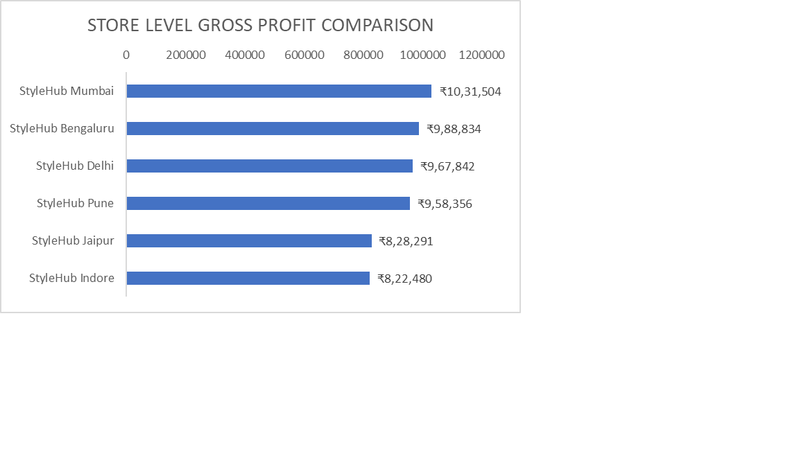

# StyleHub Retail | SQL Analysis

## About the Project

StyleHub Retail is a SQL based analysis project using a fictional fashion retail business with six stores across India.

The project examines sales transactions, product performance, customer purchasing patterns, profitability, returns, and inventory records to assess different areas of retail operations.

A relational database consisting of nine interconnected tables was used to answer 27 business questions. The analysis begins with basic data exploration and progresses to more detailed evaluations of store performance, monthly revenue changes, customer spending, and inventory management.

The objective is to understand business performance through SQL analysis and identify findings that could support better decisions related to sales, stock planning, and customer management.

## Tools & SQL Skills Used

**Tools**
- MySQL
- MySQL Workbench

**SQL Skills**
- Joins (INNER JOIN, LEFT JOIN)
- Aggregate functions (SUM, COUNT, AVG)
- GROUP BY, HAVING, and ORDER BY
- Common Table Expressions (CTEs)
- Window functions (LAG, DENSE_RANK)
- CASE statements and conditional logic
- Data quality checks

## Database Structure

The StyleHub Retail database consists of nine interconnected tables covering different areas of retail operations.

| Table | Description |
|---|---|
| customers | Customer details, location, and signup dates |
| stores | Store names, locations, and store types |
| employees | Employee information and store assignments |
| categories | Product category information |
| products | Product details, selling prices, and cost prices |
| sales | Sales transactions linked to customers, stores, and employees |
| sale_items | Products sold in each transaction, including quantities and discounts |
| returns_ | Returned items, quantities, dates, and reasons |
| inventory | Product stock levels and restocking information by store |

Primary and foreign keys connect the tables, allowing sales, customer, product, inventory, and returns data to be analyzed together.

## SQL Analysis

The analysis covers 27 business questions, organized around the following areas:

- **Sales Performance:** Sales transactions, quantities sold, store-wise revenue, and discounts.
- **Profitability:** Store-level profit margins and category-wise profitability.
- **Product Performance:** Best-selling products, category performance, and pricing.
- **Customer Analysis:** Customer distribution, purchasing behavior, and spending-based segmentation.
- **Sales Trends:** Monthly revenue, previous-month comparisons, and month-over-month growth.
- **Returns Analysis:** Product return rates and common reasons for returns.
- **Inventory Management:** Out-of-stock products, low-stock items, and products with high inventory but relatively low sales.

## Key Findings & Business Insights

**01 | Revenue & Store Performance**

Mumbai led the six-store network with ₹22.75 lakh in net revenue. However, store performance was not uniform, with a revenue gap of approximately 18.4% between Mumbai and Jaipur, the lowest-revenue store.

**02 | Profitability Beyond Revenue**

Mumbai generated the highest gross profit (₹10.32 lakh) and gross margin (45.35%). Delhi, despite ranking second in revenue, recorded the lowest gross margin (43.69%), highlighting differences in profitability across stores.

**03 | Category Contribution**

Footwear was the largest revenue contributor at ₹30.68 lakh, while Accessories delivered the highest gross profit at ₹14.31 lakh. Revenue leadership and profit contribution were therefore not concentrated in the same category.

**04 | Customer Engagement**

Of 500 registered customers, 485 completed at least one transaction, leaving 15 customers without recorded purchases during the analysis period.

**05 | Inventory Efficiency**

Seven store-product combinations met the criteria for high inventory (50+ units) and low sales (fewer than 20 units). These were concentrated in Indore and Jaipur, identifying specific areas for inventory review.

## Conclusion

The analysis highlights differences in revenue, profitability, customer activity, and inventory performance across StyleHub's retail operations.

While some stores and categories lead in sales, the findings show that higher revenue does not always translate into stronger profit margins. The analysis also identifies inventory imbalances that warrant further investigation.

Overall, the project demonstrates how SQL can be used to evaluate retail performance, identify operational gaps, and support informed business decisions.

## How to Run the Project

1. Download the SQL script and CSV datasets from this repository.
2. Open MySQL Workbench and execute `STYLE_HUB_RETAIL_FINAL.sql` to create the database and tables.
3. Import the nine CSV files from the `data` folder into their corresponding tables, following foreign key dependencies.
4. Run the SQL analysis queries after completing the data import.

### Store-Level Gross Profit Comparison

## Connect

**LinkedIn:** (https://www.linkedin.com/in/your-profile/)
